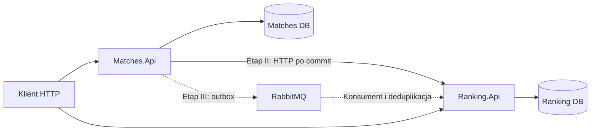

# LowOnLegs — zatwierdzony plan nauki

Status: zatwierdzony przez Adama 2026-10-14. Realizacja jeszcze się nie rozpoczęła.

## Cel i sposób współpracy

Nauka granic mikroserwisów, niezawodnej komunikacji RabbitMQ, konteneryzacji oraz wdrażania do Azure przez samodzielną rozbudowę istniejącego LowOnLegs.

**Adam wykonuje wszystkie zmiany w kodzie i polecenia. Asystent jest nauczycielem: wyjaśnia zagadnienia, przygotowuje zadania, udziela wskazówek, diagnozuje problemy i robi review. Zatwierdzenie tego planu nie upoważnia asystenta do samodzielnej implementacji.**

Plan uwzględnia ponad siedem lat doświadczenia Adama z .NET, REST API, bazami danych, RabbitMQ, Dockerem i Azure DevOps. Pomijamy kurs podstaw C# i REST. Nowym obszarem jest przede wszystkim praktyczne wdrażanie aplikacji do Azure.

Każda lekcja obejmuje cel, krótkie przygotowanie, zakres zmian i pliki, kryteria akceptacji, eksperyment oraz review. Wskazówki są stopniowane: pytanie naprowadzające → wskazówka → pseudokod → fragment rozwiązania na prośbę. Asystent nie podaje od razu kompletnych implementacji.

Orientacyjna sesja: 10 minut wyjaśnienia, 35 minut implementacji, 15 minut sprawdzenia i omówienia. Większe lekcje dzielimy na kilka sesji. Nie ustalamy sztywnego kalendarza. Po zadaniu Adam przedstawia zmiany, wynik testów i uzasadnienie decyzji. Przejście dalej wymaga spełnienia kryteriów i zrozumienia rozwiązania.

## Ustalenia

- Nowe bazy ćwiczeniowe; bez importowania starej historii lub Elo. Nie trzeba usuwać istniejących danych ani wolumenów, aby rozpocząć ćwiczenia.
- Weryfikacja przez HTTP i testy automatyczne. Zgodność frontendu odkładamy.
- Mecz kończy się przy co najmniej 11 punktach i przewadze minimum dwóch. Remis i niekompletny skład nie mogą zostać zakończone.
- Zakończone wyniki są niezmienne. Korekty i anulowania pozostają poza pierwszą wersją.
- Singiel: dwóch różnych graczy. Debel: czterech różnych graczy.
- Początkowe Elo: 1000. K = 32. W deblu jednakowa delta dla członków drużyny, przeciwna delta dla przegranych. Dolna granica ratingu: 0.
- Początkowo jeden aktywny singiel i jeden aktywny debel. Ograniczenie egzekwowane w bazie.
- .NET 10, ASP.NET Core, EF Core; SQLite do pierwszego kamienia milowego. Przed Azure przejście na SQL Server, następnie Azure SQL.
- Pierwszy kamień milowy: dwa API, osobne dane, integracja HTTP i Docker Compose, bez RabbitMQ.
- Bez Kubernetes, event sourcingu, YARP, osobnego Players.Api i dodatkowych projektów Domain/Application/Infrastructure.

Jeden aktywny mecz nie eliminuje współbieżności: dwa żądania mogą równocześnie zmienić punkty lub zakończyć rozgrywkę. Wiele meczów oznacza dodatkowo wiele niezależnych stanów i kierowanie powiadomień do odpowiednich odbiorców. Tego rozszerzenia na razie nie potrzebujemy.

## Kontekst repozytorium

Punkt wyjścia to warstwowy monolit .NET 9 z projektami API, Core, Services, Data i Infrastructure, jednym ApplicationDbContext i SQLite. Elo znajduje się w Players; aktywny singiel i debel są singletonami w pamięci. Serwisy zakończenia ignorują asynchroniczne zapisy; nie ma atomowej transakcji całego zakończenia ani trwałego ID aktywnego meczu. Delta przegranych w deblu jest dodatnia.

Plan oparto na analizie statycznej, bez uruchamiania aplikacji, migracji lub testów. Istniejący LowOnLegs_Microservices_Plan_Etap_1.md pozostaje materiałem wcześniejszym; niniejszy dokument określa zatwierdzoną kolejność nauki, w szczególności kamień milowy bez RabbitMQ.

## Docelowe projekty i własność danych

Zachowujemy jedno repozytorium i LowOnLegs/LowOnLegs.sln.

```text
LowOnLegs/
  LowOnLegs.sln
  Matches.Api/
    Controllers/
    Matches/
    Players/
    Persistence/
    Integration/
  Ranking.Api/
    Controllers/
    Ratings/
    Persistence/
    Integration/
  LowOnLegs.Contracts/
  LowOnLegs.Tests/
  Matches.Api.Tests/
  Ranking.Api.Tests/
```

Nowe ścieżki są planowane, nie opisują istniejących jeszcze projektów.

| Projekt | Odpowiedzialność |
| --- | --- |
| Matches.Api | Gracze, rozgrywka, historia, head-to-head, później outbox. |
| Ranking.Api | Elo, zastosowane wyniki, kolejność przetwarzania, później konsument RabbitMQ. |
| LowOnLegs.Contracts | Wersjonowany kontrakt wyniku, bez EF, repozytoriów i logiki Elo. |
| LowOnLegs.Tests | Testy obecnego kodu podczas przygotowania. |
| Matches.Api.Tests / Ranking.Api.Tests | Testy odpowiednich API, persystencji i awarii. |

Oba API mogą referencjonować Contracts. Nie referencjonują siebie ani implementacji drugiej usługi. Nie współdzielą DbContext, repozytoriów, encji, migracji ani logiki biznesowej. Wspólna biblioteka techniczna może powstać dopiero przy uzasadnionej powtarzalności.

Core, Data i Services pozostają przejściowo prywatnymi zależnościami dotychczasowego backendu. Potrzebny kod zostanie przeniesiony do właścicieli; usunięcie pustych projektów nastąpi na końcu wydzielenia.

Ranking identyfikuje gracza przez zewnętrzny PlayerId, bez FK do Matches DB. Zaczyna obsługiwać go od pierwszego wyniku. Lista wszystkich graczy bez rozegranego meczu pozostaje w Matches; nie dodajemy synchronizacji rejestru zawodników.



## Etap I — przygotowanie istniejącego kodu

### Lekcja 1. Test ujawniający błąd Elo w deblu

Orientacyjnie: jedna sesja.

**Nauka:** reguła biznesowa a obecna implementacja; test pokazujący konkretny błąd.

**Pliki:**
- Nowy LowOnLegs/LowOnLegs.Tests/LowOnLegs.Tests.csproj.
- Nowy LowOnLegs/LowOnLegs.Tests/EloServiceTests.cs.
- LowOnLegs/LowOnLegs.sln.
- Analizowany LowOnLegs/LowOnLegs.Services/EloService.cs.

**Zadanie:**
- [ ] Dodaj projekt xUnit i referencję do Services.
- [ ] Sprawdź singiel przy ratingach 1000/1000.
- [ ] Sprawdź deltę zwycięskiej i przegranej drużyny przy średnich 1000/1000.
- [ ] Uruchom testy i wyjaśnij wynik.

**Akceptacja:** singiel potwierdza 1016/984; test przegranej drużyny ujawnia błąd. Świadomie pozostawiamy test czerwony do następnej lekcji.

**Omówienie:** dlaczego zamiana argumentów funkcji liczącej przyrost zwycięzcy nie wylicza straty przegranego?

### Lekcja 2. Poprawna reguła Elo

Orientacyjnie: jedna sesja.

**Nauka:** wynik obu stron, zaokrąglenia, dolna granica ratingu.

**Pliki:** EloService.cs, DoubleMatchService.cs w LowOnLegs.Services; EloServiceTests.cs.

**Zadanie:**
- [ ] Popraw obliczenie i użycie delty.
- [ ] Dodaj przypadki zwycięstwa faworyta i słabszej drużyny.
- [ ] Sprawdź dolną granicę i rozdzielenie ratingów singla/debla.

**Akceptacja:** przy średnich 1000/1000 zwycięzcy dostają po +16, przegrani po −16. Faworyt zyskuje mniej niż słabsza drużyna. Debel nie zmienia Elo singlowego. Granica 0 jest stosowana świadomie.

**Eksperyment:** wyjaśnij, dlaczego przy ograniczeniu do 0 suma ratingów nie zawsze pozostaje stała.

### Lekcja 3. Przejście na .NET 10

Orientacyjnie: jedna sesja.

**Nauka:** zgodność SDK, runtime, EF i obrazów.

**Pliki:** pięć istniejących .csproj oraz testy; LowOnLegs/LowOnLegs/Dockerfile; nowy global.json; lokalny manifest narzędzi EF, jeśli używany.

**Zadanie:**
- [ ] Ujednolić .NET 10 i EF Core 10.
- [ ] Dopasować Dockerfile.
- [ ] Przejrzeć stare referencje pakietowe SignalR.
- [ ] Sprawdzić build, testy i budowę obrazu backendu.

**Akceptacja:** rozwiązanie buduje się, testy przechodzą, obraz daje się zbudować. Nie zmieniamy równocześnie architektury ani silnika bazy.

### Lekcja 4. Async i atomowe zakończenie meczu

Orientacyjnie: dwie sesje.

**Nauka:** poprawność async, granice transakcji, odpowiedzialność za zapis.

**Pliki:** kontrolery meczów; IMatchService, IDoubleMatchService; MatchService, DoubleMatchService; repozytoria i interfejsy; nowe testy zakończenia.

**Zadanie:**
- [ ] Przeprowadzić async od kontrolera do zapisu.
- [ ] Usunąć ignorowanie wyników i ukrywanie błędów.
- [ ] Zapewnić jedną transakcję dla meczu i wszystkich ratingów w monolicie.
- [ ] Resetować rozgrywkę dopiero po udanym zakończeniu.

**Akceptacja:** sukces HTTP oznacza commit; wymuszony błąd nie zostawia częściowego zapisu ani nie usuwa aktualnego meczu. Debel aktualizuje czterech graczy atomowo.

**Eksperyment:** wymusić błąd przed commit i sprawdzić rzeczywistą bazę, nie tylko mocki.

### Lekcja 5. Trwała tożsamość i stan rozgrywki

Orientacyjnie: dwie sesje.

**Nauka:** tożsamość meczu, stan procesu a trwałe dane, źródło prawdy.

**Pliki:** modele Match, DoubleMatch i stanu; ApplicationDbContext i migracja; state managery, serwisy, kontrolery; testy restartu i persystencji.

**Zadanie:**
- [ ] Zapisywać mecz przy utworzeniu i nadawać trwałe ID.
- [ ] Zapisywać punkty, uczestników i serwis.
- [ ] Zastąpić singleton jako źródło prawdy bazą.
- [ ] Dodać API wskazujące konkretny mecz.
- [ ] Ujednolicić czas do UTC.

**Akceptacja:** restart zachowuje mecz; drugi aktywny mecz tego samego typu jest odrzucany; operacje dotyczą wskazanego ID; historia działa.

Pozostają osobne modele singla i debla. Nie budujemy uniwersalnego modelu sportów.

### Lekcja 6. Walidacja, współbieżność i ponowienia

Orientacyjnie: dwie sesje.

**Nauka:** optimistic concurrency, atomowe przejście stanu, idempotencja żądania.

**Pliki:** modele, konfiguracja EF, migracja, serwisy meczów i testy API.

**Zadanie:**
- [ ] Dodać token wersji zarządzany przez aplikację dla SQLite.
- [ ] Wymusić legalny wynik i różnych uczestników.
- [ ] Zabezpieczyć przejście aktywny → zakończony.
- [ ] Powtórne zakończenie ID zwraca zapisany wynik bez nowych zmian.

**Akceptacja:** 11:10 nie kończy, 12:10 kończy. Remis, brak gracza i powtarzający się uczestnik są odrzucane. Dwa równoległe finish dają jeden wynik i jedną zmianę Elo. Punkty nie nadpisują się bez wykrycia konfliktu. Ponowienie nie kończy następnej gry.

Przy konflikcie punktacji zwracamy konflikt i wymagamy ponownego odczytu; automatyczne retry omawiamy osobno.

## Etap II — dwa API i separacja danych, bez RabbitMQ

### Lekcja 7. Wydzielenie Matches.Api i Ranking.Api

Orientacyjnie: dwie sesje.

**Nauka:** własność danych; granica projektu a granica usługi.

**Pliki:** nowe projekty API, Program.cs, konfiguracje, konteksty EF; rozwiązanie; przenoszone kontrolery, modele, serwisy i zapytania.

**Zadanie:**
- [ ] Matches przejmuje graczy, mecze, historię i head-to-head.
- [ ] Ranking przejmuje Elo i prywatny model ratingu.
- [ ] Każde API ma osobną bazę i migracje.
- [ ] Usunąć Elo z zapisywanego profilu w Matches.
- [ ] Przygotować deterministycznych graczy do testów.

**Akceptacja:** niezależny start API; Ranking nie referencjonuje Core/Data/Services drugiej usługi; Matches nie zapisuje Elo; brak FK między bazami.

### Lekcja 8. Kontrakt wyniku i aktualizacja przez HTTP

Orientacyjnie: dwie sesje.

**Nauka:** kontrakt integracji, transakcja odbiorcy, zależność sieciowa.

**Pliki:**
- LowOnLegs.Contracts/MatchFinishedV1.cs.
- Ranking.Api/Integration/FinishedMatchesController.cs.
- Ranking.Api/Ratings/ApplyFinishedMatch.cs.
- Ranking.Api/Persistence/RankingDbContext.cs.
- Matches.Api/Integration/RankingClient.cs.
- Testy obu API.

**Kontrakt:** EventId, ID i tryb meczu, sekwencja zakończenia, czas UTC, ID uczestników, punkty, zwycięska strona. PlayerId pozostaje int. Przy osobnych tabelach kluczem meczu jest para (Mode, MatchId). Kontrakt nie zawiera nowych ratingów ani danych prywatnych profilu.

**Zadanie:**
- [ ] Matches zatwierdza zakończenie, następnie przekazuje wynik przez HTTP.
- [ ] Ranking atomowo zapisuje ratingi i zastosowany wynik.
- [ ] Deduplikacja chroni również przed przesłaniem tego samego meczu z nowym EventId.

**Akceptacja:** singiel/debel aktualizują właściwy rating; powtórzenie nie zmienia Elo; inna treść dla tego samego meczu daje konflikt; brak odczytu cudzej bazy.

### Lekcja 9. Luka DB → HTTP i kolejność

Orientacyjnie: dwie sesje.

**Nauka:** częściowy sukces, spójność ostateczna, zależność Elo od kolejności.

**Pliki:** modele i migracje sekwencji; Matches.Api/Integration/FinishedMatchesExportController.cs; handler i postęp Ranking; plik .http do naprawy.

**Zadanie:**
- [ ] Nadawać wspólną transakcyjną sekwencję singlom/deblom; bez niezabezpieczonego MAX + 1.
- [ ] Ranking przyjmuje następny oczekiwany wynik lub bezpieczny duplikat.
- [ ] Odrzucać wynik z luką jako wymagający synchronizacji.
- [ ] Dodać eksport i ręczne uzupełnianie braków.

**Akceptacja:** niedostępny Ranking nie cofa wyniku; wynik jest odzyskiwalny; utrata odpowiedzi i ponowienie nie podwajają Elo; naprawa zachowuje sekwencję zakończeń.

Na tym etapie naprawa jest ręczna; automatyzacja nastąpi z outboxem.

### Lekcja 10. Compose i pierwszy kamień milowy

Orientacyjnie: jedna–dwie sesje.

**Nauka:** sieć kontenerów, konfiguracja, trwałość, readiness.

**Pliki:** Dockerfile obu API, docker-compose.yml, konfiguracje, Program.cs z health checks, scenariusz .http, README.

**Zadanie:**
- [ ] Osobne porty hosta i wolumeny SQLite.
- [ ] Nazwy usług w komunikacji między kontenerami.
- [ ] Liveness i readiness własnej bazy.
- [ ] Opis ograniczeń i demonstracyjny przepływ HTTP.

**Akceptacja M1:** jedna komenda uruchamia oba API; można utworzyć graczy, rozegrać singiel/debel i odczytać Elo; odtworzenie kontenerów zachowuje dane; awaria Ranking nie blokuje zapisu meczu; zaległości można uzupełnić; brak RabbitMQ i współdzielonego dostępu do baz.

Po M1 robimy review całego podziału.

## Etap III — RabbitMQ i odporne przetwarzanie

### Lekcja 11. Podstawowy przepływ RabbitMQ

Orientacyjnie: dwie sesje.

**Nauka:** exchange, routing key, queue, binding, trwałość, publisher confirms, consumer acknowledgements.

**Pliki:** Compose, Matches.Api/Integration/RabbitMqPublisher.cs, Ranking.Api/Integration/MatchFinishedConsumer.cs, konfiguracja i DI.

**Zadanie:**
- [ ] Użyć bezpośrednio RabbitMQ.Client.
- [ ] Dodać trwałą kolejkę, persistent messages, confirms i manual ack.
- [ ] Przełączyć automatyczne przesyłanie na broker; HTTP pozostaje diagnostyką/naprawą.

**Akceptacja:** wynik trafia przez broker; zatrzymany konsument odbiera zaległości; brak routingu jest wykrywany; brak równoległego automatycznego wysyłania HTTP i RabbitMQ.

**Eksperyment:** przerwać proces między commit a publish i zaobserwować zgubione powiadomienie. Ten wariant nie jest jeszcze odporny.

### Lekcja 12. Idempotencja konsumenta

Orientacyjnie: jedna–dwie sesje.

**Nauka:** at-least-once delivery, commit a ack.

**Pliki:** konsument, handler, persystencja deduplikacji i testy integracyjne.

**Zadanie:**
- [ ] Zapisywać ratingi i przetworzony komunikat w jednej transakcji.
- [ ] Ack dopiero po commit.
- [ ] Testować z rzeczywistym RabbitMQ, np. przez Testcontainers.

**Akceptacja:** duplikaty zmieniają Elo raz; crash przed commit pozwala ponowić; crash po commit przed ack nie podwaja zmian; debel nie zostawia częściowego zapisu.

### Lekcja 13. Transactional outbox

Orientacyjnie: dwie–trzy sesje.

**Nauka:** zamknięcie luki DB → broker bez transakcji rozproszonej.

**Pliki:** Matches.Api/Persistence/OutboxMessage.cs, kontekst i migracja, zakończenie meczu, Matches.Api/Integration/OutboxPublisher.cs, testy awarii.

**Zadanie:**
- [ ] Wynik i outbox w jednej transakcji.
- [ ] Publikacja w tle, stały EventId przy retry.
- [ ] Oznaczenie publikacji po potwierdzeniu brokera.
- [ ] Publikowanie nowych wyników według sekwencji.

**Akceptacja:** wyłączony broker nie blokuje zakończenia; restart nie gubi zaległości; crash po publish przed oznaczeniem daje bezpieczny duplikat; rollback meczu nie zostawia zdarzenia.

Zaczynamy od jednego dispatchera, bez koordynacji wielu publisherów.

### Lekcja 14. Retry, kolejność i DLQ

Orientacyjnie: dwie sesje.

**Nauka:** błędy przejściowe, wadliwe wiadomości, luki w danych.

**Pliki:** konsument, konfiguracja kolejek, retry/DLQ, testy.

**Zadanie:**
- [ ] Ograniczone retry błędów przejściowych.
- [ ] DLQ dla trwale wadliwych wiadomości.
- [ ] Wstrzymanie postępu przy luce sekwencji.
- [ ] Procedura ręcznej naprawy i wznowienia.

**Akceptacja:** brak nieskończonego natychmiastowego requeue; wadliwy wynik nie zostaje cicho pominięty; naprawa wznawia od właściwego miejsca; retry nie zmienia kolejności Elo.

Nie obiecujemy exactly-once dostarczenia. Zapewniamy jednokrotny efekt biznesowy wyniku.

## Etap IV — diagnostyka i przygotowanie do chmury

### Lekcja 15. Obserwowalność przepływu

Orientacyjnie: dwie sesje.

**Nauka:** logi strukturalne, trace context, metryki, opóźnienie.

**Pliki:** konfiguracja, Program.cs, publisher, konsument i handler.

**Zadanie:**
- [ ] Powiązać logi przez MatchId, EventId i sekwencję.
- [ ] Dodać OpenTelemetry.
- [ ] Pokazywać liczbę i wiek wpisów outboxa oraz postęp Ranking.
- [ ] Rozdzielić żywotność procesu i gotowość obsługi ruchu.

**Akceptacja:** diagnostyka pozwala wskazać, czy wynik utknął w Matches, brokerze czy Ranking.

### Lekcja 16. SQL Server i własność baz

Orientacyjnie: dwie sesje.

**Nauka:** różnice providerów, migracje, uprawnienia, kontrolowana inicjalizacja.

**Pliki:** pakiety API, konteksty i migracje, Compose, konfiguracja, testy persystencji.

**Zadanie:**
- [ ] Zastąpić SQLite lokalnym SQL Server.
- [ ] Utworzyć dwie bazy i dwa konta aplikacyjne z oddzielnymi uprawnieniami.
- [ ] Przygotować nowe migracje dla providera.
- [ ] Powtórzyć testy współbieżności na SQL Server.

**Akceptacja:** konto jednej usługi nie ma dostępu do drugiej bazy; atomowość i idempotencja działają; migracje są wykonywane kontrolowanie przed startem; zwykła praca aplikacji nie wymaga uprawnień administracyjnych.

Nie przenosimy danych ćwiczeniowych SQLite. SQL Server przygotowuje do Azure SQL przez wspólny provider EF.

## Etap V — Azure i Azure DevOps

Przed etapem sprawdzamy aktualne możliwości konta, koszty i usługi. Szczegółowy deployment dopiero wtedy. Zatwierdzenie planu nie oznacza zgody na automatyczne operacje asystenta w Azure.

### Lekcja 17. CI i publikacja obrazów

Orientacyjnie: dwie sesje.

**Nauka:** powtarzalny build, artefakty, niezależne wersje usług.

**Pliki:** nowy azure-pipelines.yml, Dockerfile, testy i dokumentacja.

**Zadanie:**
- [ ] Restore, build, testy, budowanie i publikacja obrazów.
- [ ] Oznaczać obrazy wersją/commitem.
- [ ] Zacząć od CI; CD po ręcznym wdrożeniu.

**Akceptacja:** błędne testy blokują publikację; obraz wskazuje commit; osobne obrazy usług; brak sekretów w repo.

### Lekcja 18. Pierwsze wdrożenie do Azure Container Apps

Orientacyjnie: kilka sesji.

**Nauka:** środowisko ACA, konfiguracja, logi, rewizje, tożsamość, baza.

**Zadanie:**
- [ ] Wdrożyć najpierw jedno API i sprawdzić działanie.
- [ ] Dodać drugie API oraz osobne bazy.
- [ ] Ustalić hosting RabbitMQ i sprawdzić trwałość.
- [ ] Przygotować sekrety i uprawnienia.
- [ ] Wykonać przepływ mecz → broker → rating.

**Akceptacja:** brak bazy na lokalnym filesystemie kontenera; restart nie usuwa wyników; można znaleźć logi żądania i wiadomości; znane ograniczenia replik i trwałości brokera; znany koszt oraz sposób zakończenia eksperymentu.

RabbitMQ pozostaje brokerem ćwiczeniowym. Nie zakładamy, że hosting brokera jest równie prosty jak bezstanowego API. Początkowo jedna replika każdej usługi; skalowanie wyłącznie jako osobny eksperyment.

### Lekcja 19. CD, rollback i zamknięcie projektu

Orientacyjnie: dwie–trzy sesje.

**Nauka:** rewizje, smoke tests, rollback aplikacji, zgodność schematu.

**Pliki:** pipeline, konfiguracja wdrożenia, README.

**Zadanie:**
- [ ] Połączyć pipeline z ACA.
- [ ] Dodać smoke tests.
- [ ] Przećwiczyć poprzedni obraz.
- [ ] Wyjaśnić, dlaczego rollback aplikacji nie cofa migracji.
- [ ] Opisać granice, ograniczenia i awarie systemu.

**Akceptacja:** Adam sam wdraża zmianę, rozpoznaje awarię, przywraca działającą wersję i wyjaśnia gwarancje oraz ograniczenia outboxa i idempotencji.

## Kamienie milowe i tempo

| Kamień milowy | Warunek ukończenia |
| --- | --- |
| Przygotowany monolit | Poprawne reguły, trwały stan, bezpieczne zakończenie. |
| M1: dwa API bez messagingu | Osobne dane, HTTP, Compose, naprawa rozbieżności. |
| M2: odporny messaging | RabbitMQ, outbox, idempotencja, kolejność, testy awarii. |
| M3: gotowość do chmury | SQL Server, diagnostyka, powtarzalne obrazy. |
| M4: Azure i CI/CD | Działające wdrożenie, pipeline, przećwiczony rollback. |

Orientacyjnie 30–40 godzinnych sesji, z możliwością wydłużenia infrastruktury. Liczba lekcji nie oznacza liczby spotkań. Po każdym kamieniu milowym aktualizujemy plan do rzeczywistych postępów.

Testy zapisu i współbieżności wykorzystują rzeczywisty silnik DB, nie EF InMemory. Testy messagingu wykorzystują prawdziwy RabbitMQ. Testujemy zachowanie podczas awarii, nie tylko wywołanie publishera.

## Pierwsze zadanie i postęp

Następne działanie: nauczyciel przedstawia instrukcję **Lekcji 1 — test ujawniający błędną deltę przegranych w deblu**. Adam sam tworzy projekt i testy; bez gotowej implementacji.

- [ ] Lekcja 1 — czerwony test Elo.
- [ ] Lekcja 2 — poprawna reguła Elo.
- [ ] Lekcja 3 — .NET 10.
- [ ] Lekcja 4 — async i atomowość.
- [ ] Lekcja 5 — trwały stan.
- [ ] Lekcja 6 — walidacja i współbieżność.
- [ ] Lekcja 7 — dwa API i dane.
- [ ] Lekcja 8 — kontrakt i HTTP.
- [ ] Lekcja 9 — luka i kolejność.
- [ ] Lekcja 10 — Compose; M1.
- [ ] Lekcja 11 — RabbitMQ.
- [ ] Lekcja 12 — idempotencja.
- [ ] Lekcja 13 — outbox.
- [ ] Lekcja 14 — retry, kolejność, DLQ; M2.
- [ ] Lekcja 15 — obserwowalność.
- [ ] Lekcja 16 — SQL Server; M3.
- [ ] Lekcja 17 — CI.
- [ ] Lekcja 18 — Azure.
- [ ] Lekcja 19 — CD i rollback; M4.

## Dokumentacja referencyjna

Materiały dobieramy do konkretnej lekcji; nie trzeba czytać całości z wyprzedzeniem. Wersje narzędzi i informacje o Azure sprawdzamy przed ich użyciem.

- [EF Core 10](https://learn.microsoft.com/en-us/ef/core/what-is-new/ef-core-10.0/whatsnew).
- [Provider SQL Server / Azure SQL](https://learn.microsoft.com/ef/core/providers/sql-server/).
- [RabbitMQ Reliability Guide](https://www.rabbitmq.com/docs/reliability).
- [RabbitMQ queues i kolejność](https://www.rabbitmq.com/docs/queues).
- [Storage w Azure Container Apps](https://learn.microsoft.com/en-us/azure/container-apps/storage-mounts).
- [Azure Pipelines i Container Apps](https://learn.microsoft.com/en-us/azure/container-apps/azure-pipelines).
